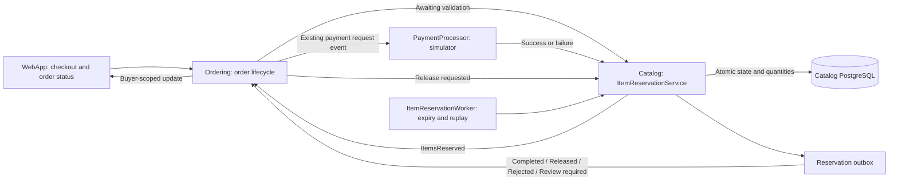

# Item reservation: a system-level review example

**Feature:** reserve all the items in an order for ten minutes while payment is processed. Complete the reservation on timely payment. Release it on failure, cancellation, or expiry. If payment arrives after release, stop fulfillment and surface a payment review.

This is an agent-built feature spanning an existing shop, not a miniature code puzzle. The feature request sounds local; the implementation changes authority, event delivery, persistence, customer communication, and cancellation behavior. The payment processor remains a simulator. No real payment or refund is performed.

## Run the shop

Use the repository's .NET SDK and a running container runtime. From the repository root:

```sh
# Normal behavior: ten-minute reservation, five-second simulated payment.
aspire run

# Presenter timings: fifteen-second reservation, payment after twenty-five seconds.
ItemReservationDemo=late-payment aspire run

# Equivalent without the Aspire CLI:
ItemReservationDemo=late-payment dotnet run --project src/eShop.AppHost
```

Stop the AppHost before switching scenarios. Use a fresh local demo environment, or let previous orders finish first. The feature changes the payment protocol; it does not migrate already in-flight orders from the old availability-check workflow.

| Scenario | Reservation | Payment | Expected result |
| --- | --- | --- | --- |
| `completed` | 60 seconds | Success after 10 seconds | Items reserved → Paid |
| `failed` | 60 seconds | Failure after 10 seconds | Items reserved → Cancelled; quantities restored |
| `cancelled` | 60 seconds | Failure after 20 seconds | Click Cancel order while reserved; duplicate failure does not restore twice |
| `expired` | 15 seconds | Failure after 25 seconds | Expiry cancels the order before payment responds |
| `late-payment` | 15 seconds | Success after 25 seconds | Expiry cancels it, then Payment review needed; cannot ship |

These overrides also shorten the existing order grace-period scan to one second. The timer starts when Catalog successfully reserves the items, not when the user opens the checkout page. Configuration fails on an unknown scenario.

Sign in with the sample's seeded `alice` / `Pass123$` account, add a product, and place an order. The Orders page shows the reservation's UTC deadline and updates when outcomes arrive. Cancel order opens a confirmation form and sends a request; it does not promise that cancellation beat payment.

## The system path to show in CodeBoarding

Start with **WebApp → Ordering.API → Catalog.API → PaymentProcessor → Ordering.API → WebApp**. Then expand Catalog's `Reservations` folder and the shared event contracts. The services coordinate through RabbitMQ; these arrows are message flows, not new HTTP calls or shared database access.



The existing internal `StockConfirmed` order status and payment-request event retain their wire names. The customer UI calls this **Items reserved**, and new feature names use **item reservation**. This deliberately avoids a broad rename of unrelated historical contracts.

| Review stop | Entry point | Question |
| --- | --- | --- |
| Customer promise | `src/WebApp/Components/Pages/User/ItemReservationStatus.razor` | What does the customer believe has happened? |
| Allocation authority | `src/Catalog.API/Reservations/ItemReservationService.cs` | Who decides whether the last item belongs to this order? |
| Cancellation boundary | `src/Ordering.API/Application/Commands/CancelOrderCommandHandler.cs` | Is this a request or a completed fact? |
| Payment boundary | `src/Catalog.API/Reservations/ItemReservationEventHandlers.cs` | Does successful payment still imply a fulfillable order? |
| Recovery | `ReservationOutboxDispatcher`, `ItemReservationWorker`, `OrderingOutboxWorker` | What survives a crash between database commit and message publication? |
| Final ownership | `Order.SetItemReservationPaymentReviewRequired` | Who resolves a payment whose item reservation has ended? |

## Deterministic evidence

```sh
dotnet test --project tests/ItemReservation.FunctionalTests/ItemReservation.FunctionalTests.csproj
dotnet test --project tests/Ordering.UnitTests/Ordering.UnitTests.csproj
dotnet test --solution eShop.Web.slnf
```

The reservation tests start and remove a dedicated PostgreSQL container on a random loopback port. They apply the real migrations and use real transactions and row locks. Lifecycle tests advance a controllable clock, rather than sleeping ten minutes. They never reset the running shop's database.

Useful tests to run in front of the audience:

- `TwoCheckoutsForLastItem_OnlyOneSucceeds`: two concurrent commands, separate database contexts, one winner.
- `LatePaymentAfterItemsWereReallocated_DoesNotConsumeAnotherOrdersItems`: the first order's late payment cannot take the second order's item.
- `ExpiryAfterRestart_RestoresItemsFromPersistedReservation`: a new service instance recovers persisted reservations.
- `FailedPublication_IsRetriedFromDurableOutboxAfterRestart`: the state commits while publication fails, then a fresh dispatcher recovers it.
- `StaleCatalogEdit_CannotOverwriteAReservation`: an existing catalog update path also needs protection.

These database tests do not prove broker routing or browser behavior; those require the running application. A green suite is evidence about the exercised behaviors, not an architectural approval.

## Decisions made, and decisions left for humans

1. **Catalog owns reservation outcomes.** Ordering becomes Paid only after Catalog confirms completion. Available quantity falls at reservation time; payment does not decrement it again. Reservations are all-or-nothing across an order's item lines.
2. **One reservation per order.** Order IDs are the idempotency key. Terminal records prevent delayed requests from reviving cancelled orders. A changed basket needs a new order, not reuse of a reservation ID.
3. **The deadline is strict.** Payment received by Catalog at or after the deadline requires review, even if the expiry worker has not run yet. Workers may return quantities later than the exact deadline. Catalog host clocks must be synchronized across replicas.
4. **Cancellation is asynchronous.** Catalog serializes it with payment and expiry. Payment may win; a cancellation request is not a refund promise. Late successful payment becomes a visible, non-shippable review state. A real payment integration needs authorization/capture semantics, provider idempotency, reconciliation, and a refund/void workflow with an accountable owner.
5. **Delivery is at least once.** Database state and outgoing outcomes commit together. Publisher confirmations precede marking the outbox sent. Retries can duplicate messages; lifecycle operations are idempotent. The sample's failed-message acknowledgement is replaced with delayed requeue. Production needs bounded retries, dead-letter handling, backlog monitoring, and retention for the outbox and tombstones.
6. **Rollout is part of correctness.** Deploy the collaborating services together in this demo and drain legacy in-flight orders. A production rollout needs a versioned contract/compatibility plan, operational metrics, and a recovery procedure before it can ship.

The graph makes these boundaries easier to find. It does not decide the payment policy, prove every message ordering safe, or replace the engineer who accepts the trade-offs.
